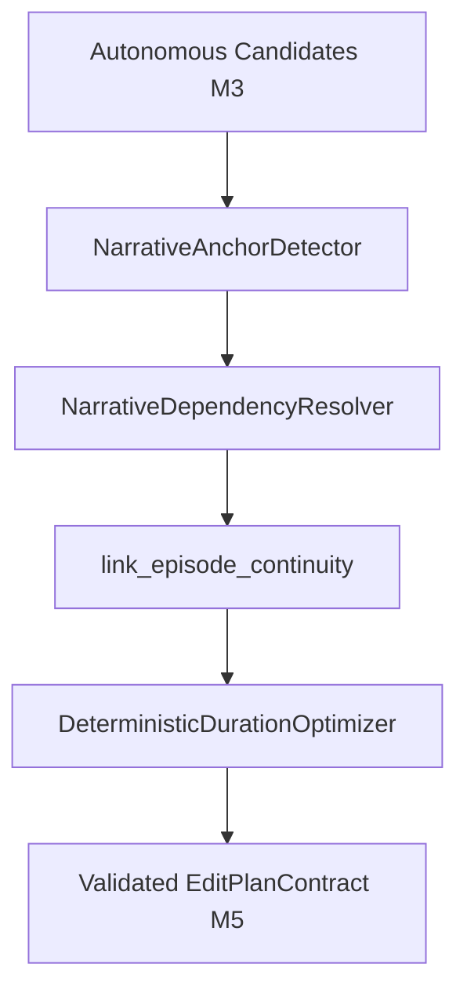

# NARRATIVE CONTINUITY ARCHITECTURE & EDITORIAL DESIGN
**StreamEditor AI — Long-Form Editorial Intelligence & Narrative Dependency Engine**  
**Date:** 2026-10-12  
**Status:** CANONICAL ARCHITECTURAL SPECIFICATION  
**Target Milestone:** M4 StoryGraph / M5 EditPlan Long-Form Generation  

---

## 1. Architectural Philosophy: Beyond Highlight Extraction

Traditional automated video editors operate under a flawed assumption:
> *"Rank all clips by audio/visual excitement, select the top N clips, sort them chronologically, and render."*

This approach inevitably fails human editorial standards on multi-hour livestreams because:
1. It produces **severe narrative fragmentation** (an average cut jumping 35 minutes).
2. It suffers from **setup-payoff decapitation** (exciting punchlines are kept while quiet, necessary setups are cut).
3. It induces **viewer disorientation** (the audience repeatedly asks: *"Why is this happening? What happened before?"*).

StreamEditor AI shifts to an **evidence-based hierarchical narrative model** grounded in how human YouTube editors think.

---

## 2. The 3-Level Hierarchical Narrative Model

```text
┌────────────────────────────────────────────────────────────────────────┐
│                        LEVEL 1: SESSION MODEL                          │
│               Complete 5.19h Livestream Broadcast Arc                  │
│   (Onboarding ──► Early Game ──► Conflict ──► Climax ──► Outro)       │
└───────────────────────────────────┬────────────────────────────────────┘
                                    │ contains 6-10 Episodes
                                    ▼
┌────────────────────────────────────────────────────────────────────────┐
│                        LEVEL 2: EPISODE MODEL                          │
│             Self-Contained Narrative Chapter (3 – 15 Minutes)          │
│   e.g. Episode 0: Session Onboarding & Weed Shop 3 Launch              │
│   e.g. Episode 6: Climax: Gang Raid on Dispensary & Combat             │
└───────────────────────────────────┬────────────────────────────────────┘
                                    │ contains 2-5 Moments
                                    ▼
┌────────────────────────────────────────────────────────────────────────┐
│                        LEVEL 3: MOMENT / BEAT MODEL                    │
│             Granular Candidate Beat (5 – 60 Seconds)                   │
│   [ Setup ] ──requires_context──► [ Action / Payoff / Reaction ]       │
└────────────────────────────────────────────────────────────────────────┘
```

### Level 1: The Session Model
- Represents the macro narrative arc of the entire broadcast (typically 4–8 hours).
- Tracks global progression milestones:
  - **Act I (0% – 25%):** Streamer greeting, audience onboarding, game launch, initial mechanics.
  - **Act II (25% – 75%):** Farming loops, economic expansion, recurring jokes, unexpected setbacks (police inspection).
  - **Act III (75% – 95%):** High-stakes conflict, final upgrade, dispensary defense raid climax.
  - **Act IV (95% – 100%):** Financial accounting, stream signoff, and community farewell.

### Level 2: The Episode Model
- A self-contained narrative unit with a defined setup, objective, development, and resolution (3–15 minutes).
- Defined by `NarrativeEpisodeContract`:
  ```python
  class NarrativeEpisodeContract(BaseModel):
      id: str
      project_id: str
      title: str
      episode_type: str  # "onboarding", "gameplay", "conflict", "raid", "outro"
      start_time: float
      end_time: float
      summary: str
      objective: str | None
      is_essential: bool
      candidate_ids: list[str]
      key_moment_ids: list[str]
  ```
- Clips within the same episode are tightly connected; intra-episode jumps of a few seconds are bridged to eliminate micro-jumpcuts.

### Level 3: The Moment / Beat Model
- Granular candidate segments (5–60s) classified into narrative roles:
  - `StoryNodeType.setup`: Establishes rules, objectives, or narrative premise.
  - `StoryNodeType.action`: The actual gameplay challenge or execution.
  - `StoryNodeType.payoff`: The punchline, victory, or consequence.
  - `StoryNodeType.reaction`: Visible facecam or vocal reaction to the payoff.

---

## 3. Semantic Dependency Contracts (EdgeRelationType)

In `packages/contracts/src/stream_editor/contracts/editorial.py`, we added directed semantic dependencies to `EdgeRelationType`:

```python
class EdgeRelationType(str, Enum):
    # Core narrative relations
    depends_on = "depends_on"
    setup_for = "setup_for"
    payoff_of = "payoff_of"
    callback_to = "callback_to"
    references = "references"
    explains = "explains"
    caused_by = "caused_by"
    consequence_of = "consequence_of"
    answers = "answers"
    introduces = "introduces"
    continues = "continues"
    contrasts_with = "contrasts_with"
    same_thread = "same_thread"

    # Semantic narrative continuity & game-state dependencies
    requires_context = "requires_context"
    introduces_objective = "introduces_objective"
    establishes_game_state = "establishes_game_state"
    changes_game_state = "changes_game_state"
    resolves_objective = "resolves_objective"
    explains_reaction = "explains_reaction"
    safe_to_skip = "safe_to_skip"
```

### Dependency Semantics
1. **`requires_context`:** A dependent action beat $B$ cannot be understood without earlier setup $A$. If $B$ is kept, $A$ must be pulled into the plan.
2. **`introduces_objective`:** Moment $A$ explains the active goal before moment $B$ attempts to complete it.
3. **`explains_reaction`:** Moment $B$ (streamer shouting in joy/frustration) is directly caused by trigger event $A$.
4. **`safe_to_skip`:** Flags routine loops (e.g. grinding weed for 10 minutes) that can be safely pruned without breaking context.

---

## 4. Algorithmic Enforcement Pipeline (M4/M5)

The complete long-form planning pipeline operates through four discrete, deterministic stages:



### 4.1 NarrativeAnchorDetector (`anchors.py`)
- Scans the stream for immutable structural anchors:
  - `STREAM_GREETING`: The earliest speaking interval [20.0s – 56.0s]. Marked `is_narrative_anchor=True`, `priority=ClipPriority.essential`.
  - `GAME_START`: Game launch and store entrance [215.0s – 275.0s]. Marked `is_narrative_anchor=True`, `priority=ClipPriority.essential`.
  - `OUTRO`: Session signoff [17170.0s – 17240.0s]. Marked `is_narrative_anchor=True`, `priority=ClipPriority.essential`.
- Anchors are **immune** to duration pruning.

### 4.2 NarrativeDependencyResolver (`resolver.py`)
- Traverses all dependency edges for selected clips:
  - If dependent clip $B$ is selected, check if prerequisite $A$ is present.
  - If $A$ is missing, automatically pull $A$ from the candidate catalog as `ClipPriority.context_only`.
  - **Priority Inheritance:** If dependent $B$ is `priority=essential`, prerequisite $A$ inherits `priority=essential` to guarantee it cannot be pruned.
  - **Prerequisite Enforcement:** If $A$ cannot be found in the candidate catalog and the dependency is `critical`, drop dependent $B$ to prevent showing an ungrounded payoff.

### 4.3 Episode Continuity Bridging (`link_episode_continuity`)
- Scans adjacent clips within the same episode:
  - If the gap between clip $i$ and clip $i+1$ is $\le 8.0\text{s}$, fuses the clips into an unbroken scene.
  - Eliminates jarring micro-jumpcuts within the same physical game location.

### 4.4 DeterministicDurationOptimizer (`optimizer.py`)
- Prunes over-budget clips starting from `context_only`, `low`, and `medium` priorities.
- Clips marked `locked=True`, `priority=essential`, or `is_narrative_anchor=True` are protected.
- Re-packs output timestamps cleanly starting from `0.0s`.

---

## 5. Content-Driven Duration Principle

Under this architecture, clip durations are **content-driven** rather than governed by rigid 30s or 50s artificial caps:
- A greeting + game onboarding episode lasts as long as the streamer takes to explain the premise (e.g. 130s).
- A quick customer transaction lasts as long as the dialogue exchange (e.g. 40s).
- A grand climax raid encompasses warning, combat, and reaction (e.g. 130s).
- The duration optimizer trims across non-essential episodes rather than slicing essential narrative units into unwatchable fragments.
